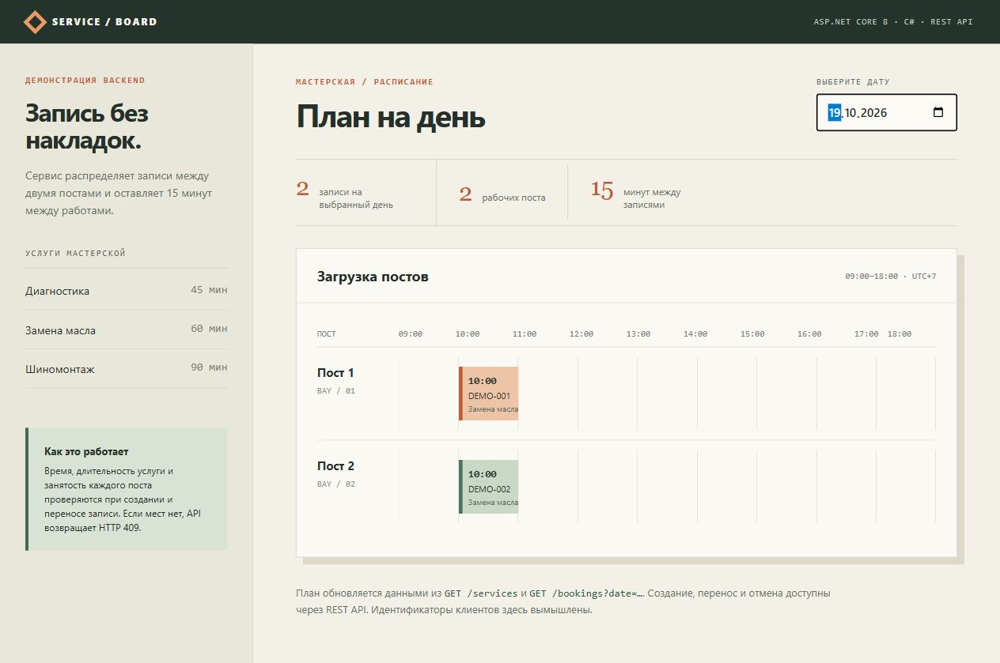

# Service Booking API

Небольшой демонстрационный backend на ASP.NET Core 8 / C#. API записывает клиентов на услуги мастерской, автоматически назначает один из двух постов и не допускает пересечений с учётом 15-минутного буфера.

## Запуск

```powershell
dotnet run --project BookingApi --urls http://localhost:5080
```

Откройте `http://localhost:5080/` — демонстрационная страница покажет записи из API. По адресу `http://localhost:5080/services` API вернёт список услуг и их длительность. Рабочие часы: понедельник–пятница, 09:00–18:00 по Томску (UTC+7). Начало записи кратно 15 минутам.

Данные хранятся в `BookingApi/data/bookings.json`. Путь можно изменить через переменную окружения `BOOKING_DATA`.

Во втором терминале запустите `./scripts/seed-demo.ps1`, чтобы создать две демонстрационные записи на одно время. Они займут разные посты, как на скриншоте ниже.



## Запросы

Создать запись:

```powershell
$body = @{ customerRef = 'DEMO-001'; serviceCode = 'oil'; startsAt = '2026-10-19T10:00:00+07:00' } | ConvertTo-Json
Invoke-RestMethod http://localhost:5080/bookings -Method Post -ContentType 'application/json' -Body $body
```

`customerRef` — технический идентификатор клиента без имени и телефона. Ответ содержит `id`, время, услугу и назначенный пост. Если оба поста заняты, API возвращает `409 Conflict`.

Посмотреть записи на день:

```powershell
Invoke-RestMethod 'http://localhost:5080/bookings?date=2026-10-19'
```

Перенести или отменить запись:

```powershell
$body = @{ startsAt = '2026-10-19T11:15:00+07:00' } | ConvertTo-Json
Invoke-RestMethod 'http://localhost:5080/bookings/ID_ЗАПИСИ' -Method Patch -ContentType 'application/json' -Body $body
Invoke-RestMethod 'http://localhost:5080/bookings/ID_ЗАПИСИ' -Method Delete
```

Проверка здоровья сервиса: `GET /health`. Некорректный запрос возвращает `400 Bad Request`, неизвестная запись — `404 Not Found`.

## Проверка

```powershell
dotnet run --project BookingApi.Tests
```

Сценарии проверяют распределение по постам, конфликт третьей записи, буфер, рабочие часы, перенос, отмену, сохранение данных между запусками и параллельные запросы.

## Границы примера

Это учебный API, а не готовая система для реальных клиентов. JSON-хранилище и блокировка работают в одном процессе; для нескольких экземпляров сервиса нужны общая БД и транзакции. Авторизация, управление персональными данными, SMS, наблюдаемость и настройка расписания не реализованы. Демонстрационные идентификаторы клиентов вымышлены.
